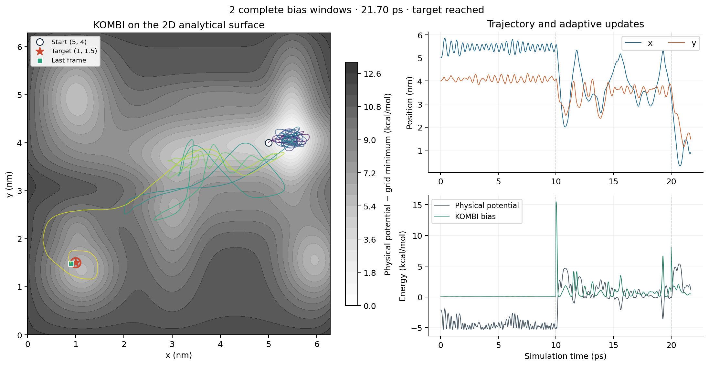

# KOMBI for PLUMED

[](https://github.com/rostaresearch/kombi-plumed/actions/workflows/tests.yml)

A native C++ implementation of **Kinetics-Optimised Markov-state Bias Iteration (KOMBI)** as a loadable [PLUMED](https://www.plumed.org) action. KOMBI collects directed transition counts under a constant bias, reconstructs a transition model, and replaces the Gaussian bias to minimise the model mean first-passage time.

Start with the **2D analytical potential** below. It runs entirely through PLUMED, requires no molecular data or GPU, and shows successive rounds of adaptive biasing. The implementation follows the corrected hard-bin 1D/2D and Ras Pi protocols. RKHS is not included.



## Install and build

On Linux, create the supplied environment with Conda or Mamba:

```bash
git clone https://github.com/rostaresearch/kombi-plumed.git
cd kombi-plumed
conda env create -f environment.yml
conda activate kombi-plumed
bash build.sh
```

The result is `build/Kombi.so`. If PLUMED and the test dependencies are already installed, use that environment instead. The build needs a C/C++17 compiler and PLUMED development headers with `LOAD` and `mklib`. Select a different PLUMED installation with `PLUMED=/path/to/plumed bash build.sh`. Build and run against the **same PLUMED installation**; compiled extensions are not portable across arbitrary versions.

The running KOMBI action is C++; Python is used for tests, example setup and plotting.

## Run the 2D analytical example

```bash
python examples/analytical_2d/run.py
python examples/analytical_2d/plot.py runs/analytical-2d
```

The particle starts at **(5, 4) nm**, with a target centred at **(1, 1.5) nm** and radius **0.1 nm**. The existing multiwell potential supplies the physical force; KOMBI supplies the adaptive force. Its 20 Gaussian hills are replaced after each 5,000-step window. The default run stops at the first target hit or after 50,000 steps.

Outputs go to `runs/analytical-2d/`:

| File | Contents |
|---|---|
| `trajectory.png` | Trajectory, coordinates and energies; all displayed energies are in kcal/mol. |
| `model_2d.COLVAR` | Per-step coordinates, physical potential, bias, model MFPT, update count and first passage. |
| `model_2d.history` | Applied biases, directed counts, reconstructed models and selected replacement biases. |
| `model_2d.state` | KOMBI checkpoint. |
| `summary.json` | Version, seed, completed steps/windows and whether the target was reached. |
| `plumed.dat`, `potential_2d.dat`, `pesmd.in`, `plumed.log` | Exact input and execution record. |

Choose a fresh directory for each run:

```bash
python examples/analytical_2d/run.py --output runs/another-seed --seed 7 --steps 100000
```

This uses PLUMED's [`pesmd`](https://www.plumed.org/doc-v2.10/user-doc/html/pesmd.html) unit-mass Langevin simulator. It demonstrates the adaptive method; it is not a reproduction of OpenMM dynamics or a measurement of unbiased kinetics. The wrapper changes the moving-particle index to account for `pesmd`'s fixed origin atom, while retaining the analytical potential and KOMBI protocol. See [example details](examples/analytical_2d/README.md).

For a fast installation check without dynamics:

```bash
(cd examples && plumed driver --plumed replay.dat --ixyz replay.xyz --timestep .002)
```

## Tests

```bash
bash test.sh
```

The tests cover directed counts, DHAM, stable MFPT and return times, binning, Gaussian forces, physical analytical potentials, adaptation timing, stopping, checkpoint/restart behaviour, and comparisons with frozen project reference code. The original suite passed **147 tests on each of PLUMED 2.10.2 and 2.11-dev**; the public package adds an end-to-end analytical-demo check. NaCl-specific reference cases are explicitly deselected because they are outside this port's scope.

See [validation](docs/validation.md) for completed checks and their limits. GitHub Actions builds the extension and runs the suite on Linux with PLUMED 2.10.2.

## Molecular simulations and optional GPU integration

The `KOMBI` action can be loaded by a PLUMED-enabled MD engine. [`examples/ras_pi.dat`](examples/ras_pi.dat) is an adaptive-bias template; its atom IDs are topology-specific and must be checked. Molecular coordinates, force fields and trajectories are not included.

An optional [OpenMM–PLUMED bridge](integrations/openmm-plumed) is included for the tested single-GPU CUDA setup. It transfers only atoms requested by PLUMED and preserves the tested KOMBI results exactly. In the recorded Ras tests it reduced bridge overhead by about twofold. It is disabled unless explicitly enabled, is separate from the KOMBI action, and is not needed for the analytical example. See [build instructions and performance evidence](docs/openmm-bridge.md).

## Method and limitations

Read the [method reference](docs/method.md) for the exact directed-count reconstruction, grid conventions, parameters, units and checkpoint semantics. The bias is replaced rather than accumulated. Counts never cross a bias-window boundary. A matched MD checkpoint, KOMBI state and history are required for a molecular restart.

The implementation supports one or two nonperiodic scalar CVs and fixed grids. The reported model MFPT is an optimisation objective, not an unbiased experimental off-rate. Seeded proposals are reproducible within this native implementation but differ from NumPy's random generator; identical historical Python trajectories are not claimed. This repository is an external extension, not an upstream PLUMED release.

## License and provenance

New code is licensed under **LGPL-3.0-or-later**, consistent with PLUMED. Third-party notices and licenses are preserved; see [NOTICE.md](NOTICE.md), [LICENSE](LICENSE) and [COPYING](COPYING). The bundled L-BFGS-B solver uses the BSD 3-Clause license. Source hashes and reference provenance are in [PROVENANCE.json](PROVENANCE.json).

Related project: [rostaresearch/KOMBI](https://github.com/rostaresearch/KOMBI).
